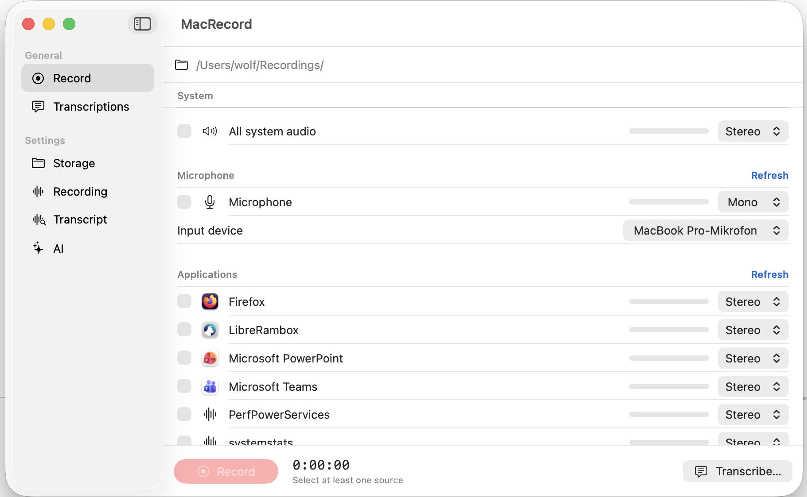
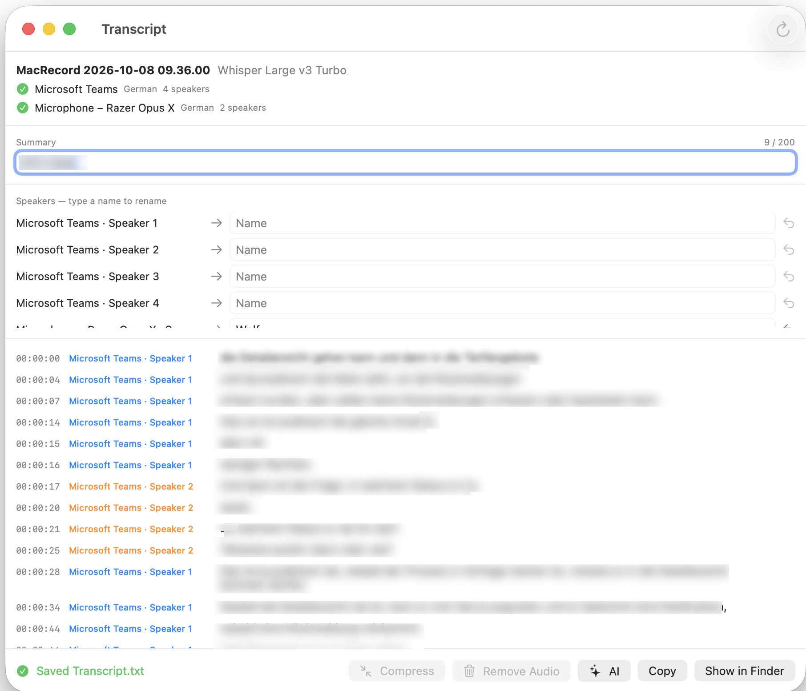

# MacRecord

Records **system audio per app** and your **microphone** as separate tracks, transcribes them **locally** with Whisper (with speaker identification), and lets you chat about the transcript with an AI model.


## Features
- **Record** any apps, all system audio and a microphone — one file per source, mono or stereo, with live meters. Saved as crash-safe CAF; optional automatic **AAC conversion**.
- **Transcribe** with [WhisperKit](https://github.com/argmaxinc/WhisperKit) (Small, Large v2, Large v3 Turbo): language hints, per-track language re-run, **speaker identification** and renaming, time-ordered transcript saved as `.txt` / `.json`, short summaries.
- **Manage** recordings: list with summaries, compress audio, or remove audio and keep the transcript.
- **AI chat** about a transcript with Anthropic Claude or any OpenAI-compatible endpoint.






## Build
```bash
git clone git@github.com:wolfposd/MacRecord.git
cd MacRecord
open MacRecord.xcodeproj   # Run with ⌘R
```
Requires Xcode and macOS 14.2+ (Core Audio process taps). Grant Microphone and System Audio Recording access on first use.

## Getting started
1. **Settings › Storage**: choose where recordings are saved.
2. **Settings › Transcript**: download a Whisper model.
3. **Record** → pick sources → Record / Stop.
4. **Transcriptions** → open a recording to transcribe it.

## Privacy
Recording and transcription run locally. The network is used only for model downloads and, if you use the AI chat, to send the transcript to the model you configured.

<https://github.com/wolfposd/MacRecord>
